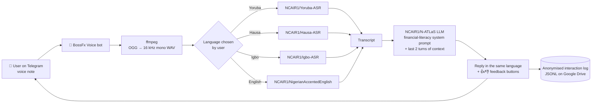

# BossFx Voice 🎙️🇳🇬

**A voice-first financial-literacy tutor for Nigerians, built on N-ATLaS.**

Ask a money question by **voice note in Yoruba, Hausa, Igbo or Nigerian English** on Telegram. BossFx Voice transcribes it with the official **N-ATLaS ASR** model for that language, answers with the **N-ATLaS LLM**, and replies in the same language: saving, budgeting, forex trading basics, risk management, and how to spot "double your money" scams.

> Submission to the **National AI Innovation Challenge 2026** (FMCIDE · NCAIR · ONDI)
> **Problem Statement 02: Voice-First Access** · **Track: Innovation & Enterprise**
> Team: **BFX Academy LTD**

🔗 **Live bot:** [t.me/BossFxVoiceBot](https://t.me/BossFxVoiceBot)

*N-ATLaS is an initiative of the Federal Ministry of Communications, Innovation and Digital Economy, and powered by Awarri Technologies.*

---

## The problem

Millions of Nigerians are targeted by investment and trading scams (Ponzi schemes, fake "account managers", "double your money in 7 days" offers), and most financial education is delivered only in written English. People who are more comfortable *speaking* Yoruba, Hausa or Igbo, or who struggle with reading, are left out of exactly the information that would protect them.

## The solution

BossFx Voice meets people where they already are: **WhatsApp-style voice notes on a messaging app**, in their own language.

- 🎙️ **Speak, don't type**: voice notes in Yoruba, Hausa, Igbo or Nigerian English
- 🧠 **Sovereign AI end to end**: speech recognition *and* answers both run on N-ATLaS
- 🚨 **Scam-aware by design**: flags guaranteed returns and "send money to my account manager" patterns
- 📚 **Education, not signals**: never tells users what to buy or sell, and always reminds them to only risk what they can afford to lose
- 🔒 **Privacy-preserving**: users are pseudonymised (hashed IDs); no names or phone numbers are stored

---

## How it works

1. The user taps **/start** and chooses a language (Yorùbá · Hausa · Igbo · English).
2. They send a **voice note**. The bot downloads it and converts it to 16 kHz mono audio.
3. The **official N-ATLaS ASR model for that language** transcribes it (30-second chunking for longer notes).
4. The transcript, a financial-literacy system prompt and the last two conversational turns go to **N-ATLaS**, which generates an answer *in the user's language*.
5. The bot replies with what it heard (🗣️) and its answer (💬), plus **👍 Helpful / 👎 Not helpful** buttons.
6. Every interaction (transcript, response, language, latency, rating) is appended to an anonymised log used for real-world validation.

---

## N-ATLaS integration

BossFx Voice uses **five N-ATLaS models** and **no other foundation model**. There is no GPT, Gemini, Whisper-base or other wrapper anywhere in the pipeline.

| Role | Model | Where in code |
|---|---|---|
| Answer generation (LLM) | [`NCAIR1/N-ATLaS`](https://huggingface.co/NCAIR1/N-ATLaS) (Llama-3 8B fine-tune) | Notebook cell 3 (load), cell 4 `ask_natlas()` |
| Yoruba speech recognition | [`NCAIR1/Yoruba-ASR`](https://huggingface.co/NCAIR1/Yoruba-ASR) | Cell 3 `ASR_IDS["yo"]`, cell 4 `transcribe()` |
| Hausa speech recognition | [`NCAIR1/Hausa-ASR`](https://huggingface.co/NCAIR1/Hausa-ASR) | Cell 3 `ASR_IDS["ha"]`, cell 4 `transcribe()` |
| Igbo speech recognition | [`NCAIR1/Igbo-ASR`](https://huggingface.co/NCAIR1/Igbo-ASR) | Cell 3 `ASR_IDS["ig"]`, cell 4 `transcribe()` |
| Nigerian English speech recognition | [`NCAIR1/NigerianAccentedEnglish`](https://huggingface.co/NCAIR1/NigerianAccentedEnglish) | Cell 3 `ASR_IDS["en"]`, cell 4 `transcribe()` |

Integration details:

- **Prompt format:** uses N-ATLaS's own chat template via `tokenizer.apply_chat_template(..., date_string=...)`, exactly as documented on the model card.
- **Generation settings:** follow the model card (`repetition_penalty=1.12`, greedy/low-temperature decoding), with `max_new_tokens=350` to keep voice-friendly answers short.
- **Quantisation:** on a 16 GB T4 GPU the LLM is loaded in 4-bit NF4 (bitsandbytes) so it fits alongside all four ASR models. The weights are N-ATLaS's own, quantised at load time. Set `USE_4BIT = False` on a larger GPU to run full fp16.
- **Every logged interaction records the exact `asr_model` and `llm_model` used**, so integration is verifiable per request in the validation data.

See [`docs/NATLAS_INTEGRATION.md`](docs/NATLAS_INTEGRATION.md) for the full integration evidence.

---

## Real-world validation

Problem Statement 02 requires **at least 50 documented real user interactions**. Validation is built into the product:

- Each interaction is logged to `interactions.jsonl` with: timestamp, pseudonymous user ID (salted SHA-256, 12 chars), language, input type (voice/text), audio length, transcript, response, ASR latency, total latency, and models used.
- Users rate each answer **👍 / 👎**, logged as separate feedback events linked by `interaction_id`.
- **Notebook cell 7** generates the validation report: total interactions, voice vs text, unique users, breakdown by language, average response time, helpful rate and error count. It exports `validation_interactions.csv` and `validation_summary.json`.

Testers were recruited from the **BossFx Academy community** (Telegram and WhatsApp), real Nigerian learners asking real questions about money, saving and trading.

---

## Running it yourself

**Requirements:** a Google account (Colab, free T4 GPU), a Hugging Face account, and a Telegram bot token.

1. **Accept the N-ATLaS terms** on Hugging Face for all five models listed above (click *Agree and access repository* on each page).
2. Create a Hugging Face **Read** token: Settings → Access Tokens.
3. Create a Telegram bot with [@BotFather](https://t.me/BotFather) (`/newbot`) and copy the token.
4. Open [`BossFx_Voice_NATLaS.ipynb`](BossFx_Voice_NATLaS.ipynb) in Google Colab. Runtime → Change runtime type → **T4 GPU**.
5. In Colab's 🔑 **Secrets** panel add `HF_TOKEN` and `TELEGRAM_TOKEN`, with notebook access on.
6. **Runtime → Run all.** Allow Google Drive access (interaction logs persist there).

| Cell | What it does |
|---|---|
| 1 | Installs dependencies (`transformers`, `accelerate`, `bitsandbytes`, `pyTelegramBotAPI`, `librosa`) |
| 2 | Loads secrets, mounts Google Drive for persistent logs |
| 3 | Loads N-ATLaS LLM + the four N-ATLaS ASR models (~8–10 min first run) |
| 4 | Core pipeline: `transcribe()`, `ask_natlas()`, logging |
| 5 | Smoke test: one question per language |
| 6 | Starts the Telegram bot in a background thread and prints the bot link |
| 7 | Validation report (re-run any time) |

**Hardware:** fits on a single NVIDIA T4 (16 GB) with the LLM in 4-bit. Typical latency on T4 is 6–20 s per voice question.

---

## Responsible AI

- **Education, not financial advice.** The system prompt forbids trading signals, buy/sell recommendations and profit promises, and requires scam warnings and risk reminders. Users are told this on /start.
- **Privacy.** Telegram user IDs are salted and hashed before logging; no names, usernames or phone numbers are stored. Users are informed on /start that questions are logged anonymously to improve the service.
- **Attribution and licence.** Uses N-ATLaS under its Open-Source Research and Innovation License with the required attribution, within the 1,000 active-user cap.

## Known limitations

We report these openly, as the N-ATLaS terms ask:

- **Yoruba answers** are understandable but often lack full tone marks. This matches the lower Yoruba fluency scores on the N-ATLaS model card. Yoruba **transcription** keeps tone marks well.
- **Code-switching** (e.g. Yoruba-English mixing, common in real speech) reduces ASR accuracy.
- **Noisy audio** and long voice notes reduce transcription quality.
- **Nigerian Pidgin** is not a separate option yet; Pidgin speakers currently use the English model.
- **Hosting:** the prototype runs on a Colab GPU. Production would move to a dedicated GPU server or the N-ATLaS API.

## Roadmap

1. **WhatsApp channel**: most of our community lives on WhatsApp.
2. **Voice replies (TTS)** in each language, for users who can't read comfortably.
3. **Sector fine-tune**: a financial-literacy and scam-awareness dataset in all four languages, built from logged questions, to improve answer quality (especially Yoruba).
4. **Pidgin support** and automatic language detection.
5. **Partnerships** with cooperatives, market associations and microfinance banks for offline-first outreach.

---

## Team: BFX Academy LTD

| Name | Role |
|---|---|
| **Timilehin Shobande** | Team Lead & AI Engineer. Founder/CEO, BFX Academy LTD; B.Sc. Computer Science, University of Lagos |
| **Shuaib Hauwa** | Community & User Validation Lead. Social Media & Customer Support, BFX Academy LTD |

🌐 [bossfxcademy.com](https://bossfxcademy.com)

---

### Attribution

N-ATLaS is an initiative of the Federal Ministry of Communications, Innovation and Digital Economy, and powered by Awarri Technologies. The N-ATLaS ASR models are developed by Awarri Technologies in partnership with the Federal Government of Nigeria.
